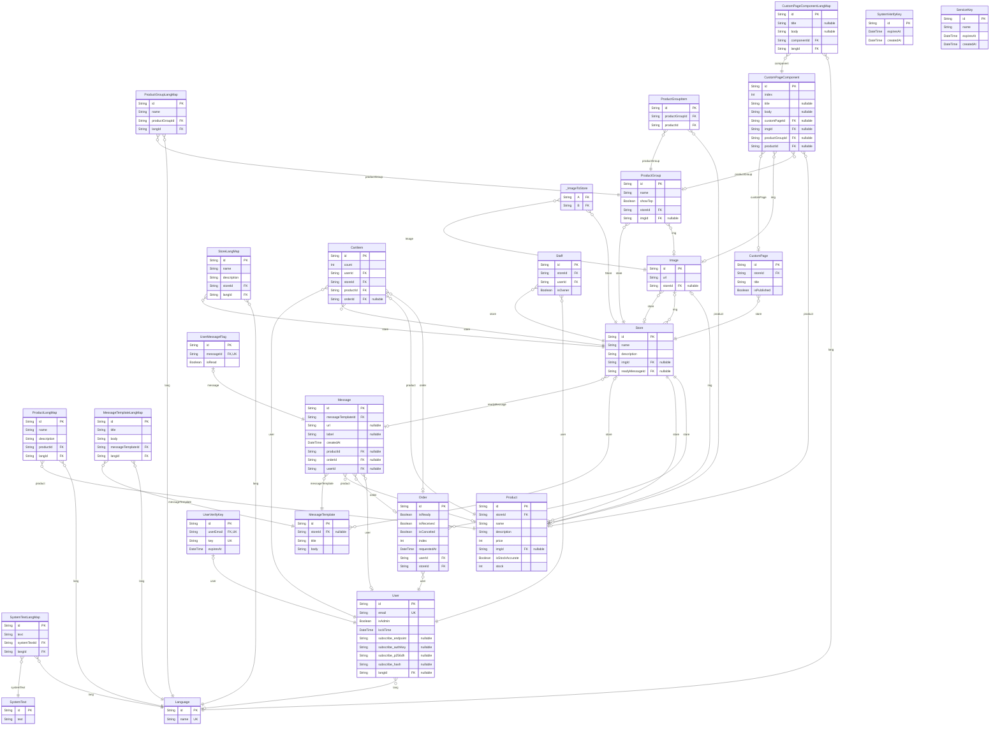

# Web Store ERD

> Generated by [`prisma-markdown`](https://github.com/samchon/prisma-markdown)

- [default](#default)

## default

### `Image`

Properties as follows:

- `id`:
- `url`:
- `storeId`:

### `Language`

Properties as follows:

- `id`:
- `name`:

### `SystemText`

Properties as follows:

- `id`:
- `text`:

### `SystemTextLangMap`

Properties as follows:

- `id`:
- `text`:
- `systemTextId`:
- `langId`:

### `Store`

Properties as follows:

- `id`:
- `name`:
- `description`:
- `imgId`:
- `readyMessageId`:

### `StoreLangMap`

Properties as follows:

- `id`:
- `name`:
- `description`:
- `storeId`:
- `langId`:

### `ProductGroup`

Properties as follows:

- `id`:
- `name`:
- `showTop`:
- `storeId`:
- `imgId`:

### `ProductGroupLangMap`

Properties as follows:

- `id`:
- `name`:
- `productGroupId`:
- `langId`:

### `ProductGroupItem`

Properties as follows:

- `id`:
- `productGroupId`:
- `productId`:

### `Product`

Properties as follows:

- `id`:
- `storeId`:
- `name`:
- `description`:
- `price`:
- `imgId`:
- `isStockAccurate`:
- `stock`:

### `ProductLangMap`

Properties as follows:

- `id`:
- `name`:
- `description`:
- `productId`:
- `langId`:

### `CartItem`

Properties as follows:

- `id`:
- `count`:
- `userId`:
- `storeId`:
- `productId`:
- `orderId`:

### `Order`

Properties as follows:

- `id`:
- `isReady`:
- `isReceived`:
- `isCanceled`:
- `index`:
- `requestedAt`:
- `userId`:
- `storeId`:

### `User`

Properties as follows:

- `id`:
- `email`:
- `isAdmin`:
- `lockTime`:
- `subscribe_endpoint`:
- `subscribe_authKey`:
- `subscribe_p256dh`:
- `subscribe_hash`:
- `langId`:

### `Staff`

Properties as follows:

- `id`:
- `storeId`:
- `userId`:
- `isOwner`:

### `MessageTemplate`

Properties as follows:

- `id`:
- `storeId`:
- `title`:
- `body`:

### `MessageTemplateLangMap`

Properties as follows:

- `id`:
- `title`:
- `body`:
- `messageTemplateId`:
- `langId`:

### `Message`

Properties as follows:

- `id`:
- `messageTemplateId`:
- `url`:
- `label`:
- `createdAt`:
- `productId`:
- `orderId`:
- `userId`:

### `UserMessageFlag`

Properties as follows:

- `id`:
- `messageId`:
- `isRead`:

### `CustomPage`

Properties as follows:

- `id`:
- `storeId`:
- `title`:
- `isPublished`:

### `CustomPageComponent`

Properties as follows:

- `id`:
- `index`:
- `title`:
- `body`:
- `customPageId`:
- `imgId`:
- `productGroupId`:
- `productId`:

### `CustomPageComponentLangMap`

Properties as follows:

- `id`:
- `title`:
- `body`:
- `componentId`:
- `langId`:

### `UserVerifyKey`

Properties as follows:

- `id`:
- `userEmail`:
- `key`:
- `expiresAt`:

### `SystemVerifyKey`

Properties as follows:

- `id`:
- `expiresAt`:
- `createdAt`:

### `ServiceKey`

Properties as follows:

- `id`:
- `name`:
- `expiresAt`:
- `createdAt`:

### `_ImageToStore`

Pair relationship table between [Image](#Image) and [Store](#Store)

Properties as follows:

- `A`:
- `B`:
